# 星澜电商 · 现状流程图

> 案例：活动热闹，毛利却变少了　|　方法：workflow-decomposition（人工现状泳道 → 失败方式 → 智能体/工具边界 → 校验与人工升级路径）　|　依据：f00~f55、ecommerce-marketing-01~04、discovery-report.md　|　整理时间：2026-11-05

> 本文件回答一个问题：现在这件事到底是怎么干的。交付链为"现状流程 → 失败方式 → 智能体/工具边界 → 校验与人工升级路径"。图中所有步骤来自角色陈述，不是现场观察记录；六岗"具体事件"在资料 04 中均标注"待访谈核实"，因此本图是纸面口径 + 一线自述偏差的合成，须用现场观察与业务日志校验。

- **【已采】** 有角色陈述或事实编号
- **【待采集】** 需原始记录或观察
- **【待确认】** 口径、时限或责任人未定
- **【硬边界】** 材料限定红线

## 一、触发、输入与输出

| 项 | 内容 |
|---|---|
| **触发** | 促销档期 / 活动策划需求；立项由营销运营总监推动（`f04`）。每月约 24 场活动（`f12` `f51`） |
| **输入资料** | 活动规则、优惠优先级、购物车样本、成本与退款事件（`f21`）；按生效日期与适用范围选规则版本（`f24`）。【待采集】 完整事件记录、字段清单与来源系统对照表 |
| **系统** | 活动平台（规则配置）、价格引擎（价格计算）、经营分析库（结果分析）；账号权限独立维护、业务状态无统一视图（`f30`） |
| **输出** | 复盘报告（现 7 天，目标 2 天，`f00`）、异常交接与转人工记录（`f23` `f44`）、每次建议的审计留痕（`f45`） |
| **节点耗时** | 【待采集】 管理层"还没有分别量出每个节点的等待和处理时间"（`f01`），因此本图**无法标注各阶段耗时，也无法指认瓶颈** |

## 二、人工现状泳道图

> 六条泳道 × 六个阶段，共 15 个处理步骤。按编号 S01→S15 阅读；类型标记：E 执行点 / J 判断点 / C 确定性校验 / X 异常 / H 交接。红色虚线为异常与转人工分支，粗竖线为不可逆动作边界。

> 完整泳道图见同目录 `星澜电商-现状流程图.svg`（与本文件同源，可用浏览器直接打开或插入文档）。以下为 Mermaid 简图，按编号 S01→S15 阅读。

```mermaid
flowchart LR
  subgraph P1["1 活动规划"]
    S01["S01 立项 目标与预算<br/>顾明岚"]
    S02["S02 流程定义<br/>唐映秋"]
  end
  subgraph P2["2 规则配置"]
    S03["S03 规则配置<br/>唐映秋"]
    S04["S04 冲突裁决<br/>傅景"]
  end
  subgraph P3["3 商品报名"]
    S05["S05 交接五要素<br/>唐映秋"]
    S06["S06 商品报名 600 SKU<br/>林亦舟"]
  end
  subgraph P4["4 试算"]
    S07["S07 离线试算<br/>秦芮"]
    S08["S08 规则核对 仅正常购物车<br/>林亦舟"]
  end
  subgraph P5["5 上线审核"]
    S09["S09 异常暴露<br/>林亦舟"]
    S10["S10 确定性校验<br/>唐映秋"]
    S11["S11 授权审核<br/>傅景"]
    S12["S12 上线放行 不可逆<br/>顾明岚"]
  end
  subgraph P6["6 复盘"]
    S13["S13 数据闸门<br/>秦芮"]
    S14["S14 复盘报告 三口径<br/>顾明岚"]
    S15["S15 反馈闭环<br/>叶书"]
  end
  S01 --> S02 --> S03 --> S04 --> S05 --> S06 --> S07 --> S08
  S08 -.->|异常| S09
  S09 -.->|转人工| S10
  S10 --> S11
  S11 --> S12
  S11 -.->|否决/停止| S09
  S12 --> S13 --> S14 --> S15
  classDef bad fill:#FCEBEB,stroke:#A32D2D,color:#501313;
  class S08,S09,S12 bad;
```

> **注意**
> 读图要点：缺陷集中在 S08 → S09：规则核对只覆盖正常购物车（f10），异常要等到分拣或顾客反馈才暴露（访谈 r1），也就是故障发现晚于不可逆动作 S12。这解释了为什么"负应付金额为零"被定为验收硬线，也解释了首期为什么只做离线回放——回放不改变 S12 之后的任何真实交易。

## 三、15 个步骤明细（现状 → 失败方式）

| 编号 | 类型 | 泳道 / 阶段 | 动作（现状口径） | 输入 / 输出与交接 | 失败方式 | 依据 |
|---|---|---|---|---|---|---|
| S01 | E | 顾明岚 / 1 | 立项，定目标、范围、预算 | 输出：目标 14→2 次、7→2 天；22 万 | 目标口径未定（配置错误 vs 执行偏差；初稿 vs 可决策版），验收说不清 | `f00` `f03` `f04` |
| S02 | E | 唐映秋 / 1 | 定义每步输入、输出、待办责任人；退回保留原因 | 输出：流程口径与责任划分 | 只是纸面口径，现场实际执行需另找林亦舟核实 | `f20` |
| S03 | E | 唐映秋 / 2 | 按生效日期与适用范围选规则版本，配置优惠优先级 | 输入：活动规则；输出：生效版本 | 选错版本 / 版本未按范围生效 | `f24` `f21` |
| S04 | J | 傅景 / 2 | 规则冲突时附两个版本交审计裁决，不自行合并、不选宽松条款 | 交接：两版本 → 审计 | 擅自合并或选宽松条款 → 越权 | `f24` `f44` |
| S05 | H | 唐映秋 / 3 | 交接含业务编号、版本、状态、未解决事项、接手人；对方确认才算完成 | 输出：交接记录 | 只发消息不算完成；关键说明留便签/群、未随单据交接 | `f23` `f14` |
| S06 | E | 林亦舟 / 3 | 商品报名，每场约 600 SKU，登记成本与退款事件 | 输入：SKU 与成本退款事件 | 退款拆单事件未与门槛规则关联 | `f12` `f21` |
| S07 | E | 秦芮 / 4 | 价格引擎离线试算，接口仅可读、不自动发布或调价 | 输出：试算结果（只读） | 接口中断 → 用带时间戳只读快照并按业务编号去重补齐 | `f32` `f35` |
| **S08** | J | 林亦舟 / 4 | **规则核对：人工只检查正常购物车**，核对约 2 人天 | 输入：购物车样本 | **核心缺陷**：极端 / 非标购物车漏检；异常无法在此拦截 | `f10` `f12` |
| **S09** | X | 林亦舟 / 5 | 异常暴露：退款拆单后门槛重算不清，出现优惠超过商品金额 | 触发：转人工 | 常在分拣或顾客反馈才暴露，**晚于上线**；建议须显示原记录与待确认字段、错误结果不得覆盖 | `f11` `f15` `f44` |
| S10 | C | 唐映秋 / 5 | 确定性校验：负应付金额为零、极端购物车覆盖 100%、原记录比对 | 输出：校验结论 | 样本由谁提供、100% 如何核验、谁签字**全未定** | `f02` `f42` `f15` |
| S11 | J | 傅景 / 5 | 授权审核：促销上线、补贴资金、消费者争议；可因关键风险否决 | 输出：签核 / 否决 | 借用他人账号、绕过审核；授权人员名单未列 | `f40` `f41` `f04` |
| **S12** | E | 顾明岚 / 5 | **上线放行（不可逆动作）** | 输出：线上活动生效 | 一旦放行，资金与消费者影响不可撤销；触及停止条件须暂停试点并复盘 | `f42` `f05` |
| S13 | C | 秦芮 / 6 | 数据归集与质量闸门：每小时更新、超期标待刷新；校验主编号/事件时间/版本；歧义进人工修复队列 | 输出：可用复盘数据集 | 补贴承担方缺字段、毛利未含退货与运费；三系统无统一视图 | `f34` `f33` `f31` `f30` |
| S14 | E | 顾明岚 / 6 | 复盘出报告（现 7 天，目标 2 天） | 输出：复盘报告 | 三口径并存（成交额 / 毛利 / 扣补贴退款后收益），各说各话、归因失真 | `f00` `f50` `f53` |
| S15 | H | 叶书 / 6 | 服务解释与反馈闭环：投诉关联原业务编号与当时版本、每周收集三方误判、先复测再更新规则版本 | 输出：改进待办与新版本 | 未经确认承诺赔偿或结果；用通知数量代替实际完成量；复测不通过时版本是否冻结未定 | `f54` `f55` `f51` |

## 四、失败方式清单（按发现时点与可拦截性）

| # | 失败方式 | 发生步骤 | 何时被谁看见 | 损害前可拦截 | 可撤销 | 控制手段 |
|---|---|---|---|---|---|---|
| 1 | 极端 / 非标购物车漏检 | S08 | 常晚至分拣或顾客反馈（一线） | 否 | 否 | 离线回放、极端购物车覆盖 100% |
| 2 | 退款拆单门槛重算不清、优惠超商品金额 | S09 | 同上 | 否 | 否 | 负应付金额为零；强制转人工（`f44`） |
| 3 | 规则版本选错 / 两版本冲突被擅自合并 | S03 S04 | 审计复核时（傅景） | 能 | 能（未上线前） | 按生效日期与范围选版本、冲突附两版本交审计 |
| 4 | 交接说明留在便签或群、未随单据交接 | S05 | 异常回溯时（一线 / 唐映秋） | 部分 | 能 | 交接五要素 + 接手确认；草稿暂存并标最后同步时间 |
| 5 | 建议覆盖原记录 / 越权放行 | S09 S11 | 事后审计 | 能 | 否（若已上线） | 显示原记录与待确认字段、错误结果不覆盖；授权审核 |
| 6 | 数据字段缺失、三系统状态不一致 | S13 | 复盘归因时（秦芮 / 顾明岚） | 能 | 能 | 数据质量闸门、歧义进人工修复队列、只读快照 |
| 7 | 三口径并存导致复盘解释失真 | S14 | 报告交付时（顾明岚 / 叶书） | 能 | 能 | 固定分母、排除规则与统计周期；主口径待裁定 |
| 8 | 接口中断 / 信息过期 | S07 S13 | 使用时（秦芮） | 能 | 能 | 带时间戳只读快照、超期标"待刷新"、按业务编号去重补齐 |

> 框架提醒：**不要把模型置信度等同于业务风险**。失败 1、2 之所以最危险，不是因为模型容易判错，而是因为它们在现状里**晚于不可逆动作才被发现**。

## 五、智能体 / 工具边界（哪些步骤可以交给系统）

| 步骤组 | 可做程度 | 允许的能力 | 禁止 / 依据 |
|---|---|---|---|
| S03 S07 S08 | 【首期可试（离线只读）】 | 读取活动规则与版本、拿试算结果、对历史购物车做叠加判定与差异比对、给出解释 | 【硬边界】 不自动发布活动、不调整线上价格（`f32`）；仅历史资料回放、不直接替换现有业务（`f05`） |
| S10 | 【可做确定性校验】 | 负应付金额检查、极端购物车覆盖检查、原记录与待确认字段并排显示 | 校验结论只是建议，须人工复核；错误结果不得覆盖原记录（`f15`） |
| S13 | 【可做数据闸门】 | 校验主编号 / 事件时间 / 版本字段；把歧义记录分流到人工修复队列 | 歧义记录**不得进入自动推荐样本**（`f33`）；字段清单与权威来源系统待核实 |
| S14 | 【有条件可做】 | 按已裁定口径生成可追溯的多口径解释素材 | 主口径未裁定前不得自动出结论（`f50` `f53`） |
| S04 S09 S11 | 【必须人工】 | 系统只能辅助提示、附两版本、标注触发原因 | 规则冲突裁决、异常兜底、上线/补贴/争议审核均须授权人员；AI 不能替代审核或直接放行 / 拦截（`f24` `f44` `f40`） |
| S12 | 【禁止自动化】 | — | 不可逆动作；不自动改价、不发放资金（`f05` `f52`）；触及停止条件暂停试点（`f42`） |
| S05 S15 | 【人主导】 | 系统可暂存草稿、记录时间戳、关联原业务编号与版本 | 对方确认接手才算完成（`f23`）；未经确认不承诺赔偿或结果（`f54`） |

## 六、不可逆动作前的确定性校验与人工升级路径

| 触发情形 | 前置确定性校验 | 具名人工接收人 | 确认 / 时限 | 升级路径 / 停止 |
|---|---|---|---|---|
| 退款拆单重算不清、优惠超商品金额 | 负应付金额为零、原记录与待确认字段并排 | 唐映秋（价格规则专员）核对后分派实际处理人 | 须标注触发原因、接手人、确认时间（`f44`）；【确认时限待确认】 | 超约定时限 → 顾明岚；触及停止条件 → 暂停试点并由负责人复盘（`f25` `f42`） |
| 资料缺少依据 / 两版本冲突 | 附两版本、不自行合并、不选宽松条款 | 傅景（交易审计经理）裁决 | 书面确认（`f24`） | 关键风险可否决上线（`f04`） |
| 关键系统不可用 / 接口中断 | 切换带时间戳只读快照、显示"暂未更新"、按业务编号去重补齐 | 秦芮；现有人工流程继续运行 | 信息超一个更新周期标"待刷新"（`f34` `f35`） | 不反复触发同一待办 |
| 低置信 / 歧义记录 | 校验主编号、事件时间、版本字段 | 秦芮 + 唐映秋共同确认修复队列判定标准 | 歧义记录不进自动推荐样本（`f33`） | 进人工修复队列 |
| 越权 / 借用账号 / 绕过审核 | 授权岗位校验、不得借用他人账号 | 对应审批人（名单【待确认】） | 涉及最终决定、对外承诺或资产变更须审批人确认（`f41`） | 促销上线 / 补贴资金 / 消费者争议授权审核（`f40`） |
| 争议 / 投诉 | 先关联原业务编号与当时资料版本，再查交接是否完成 | 叶书受理、唐映秋核对 | 未经确认不承诺赔偿或结果（`f54`） | 每周反馈由顾明岚确认改进负责人；先复测再更新版本（`f55`） |

> **要点**
> 流程建模结论：现状的失败不是"算得慢"，而是故障发现点（S09）落在不可逆动作（S12）之后，同时数据闸门（S13）与口径裁定（S14）又都在事后，导致毛利既可能真亏、又算不清、还说不一致。因此首期智能体的正确落点是 S03/S07/S08 的离线只读回放 + S10 的确定性校验，把发现点前移到 S12 之前，而不是去替换 S11/S12 的人工审核。

> **注意**
> 本图尚未核实的三件事：① 各节点等待与处理时间（f01），故无法标注瓶颈；② 极端购物车样本与 100% 覆盖核验方法（S10 无法真正执行）；③ 交接确认时限与超时升级阈值（升级路径的具体阈值未知）。须用现场观察与业务日志校验本图，不能把纸面泳道当成实际执行记录。
